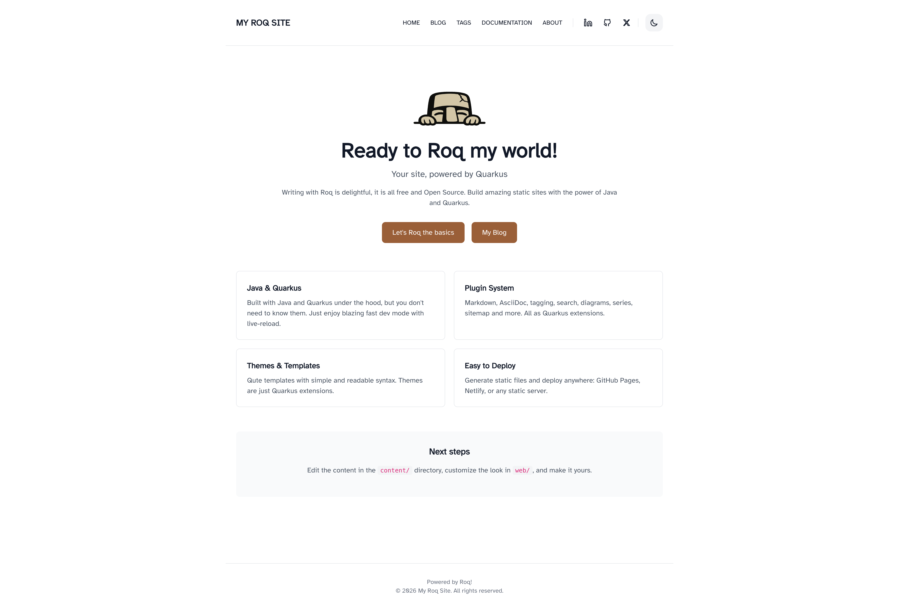
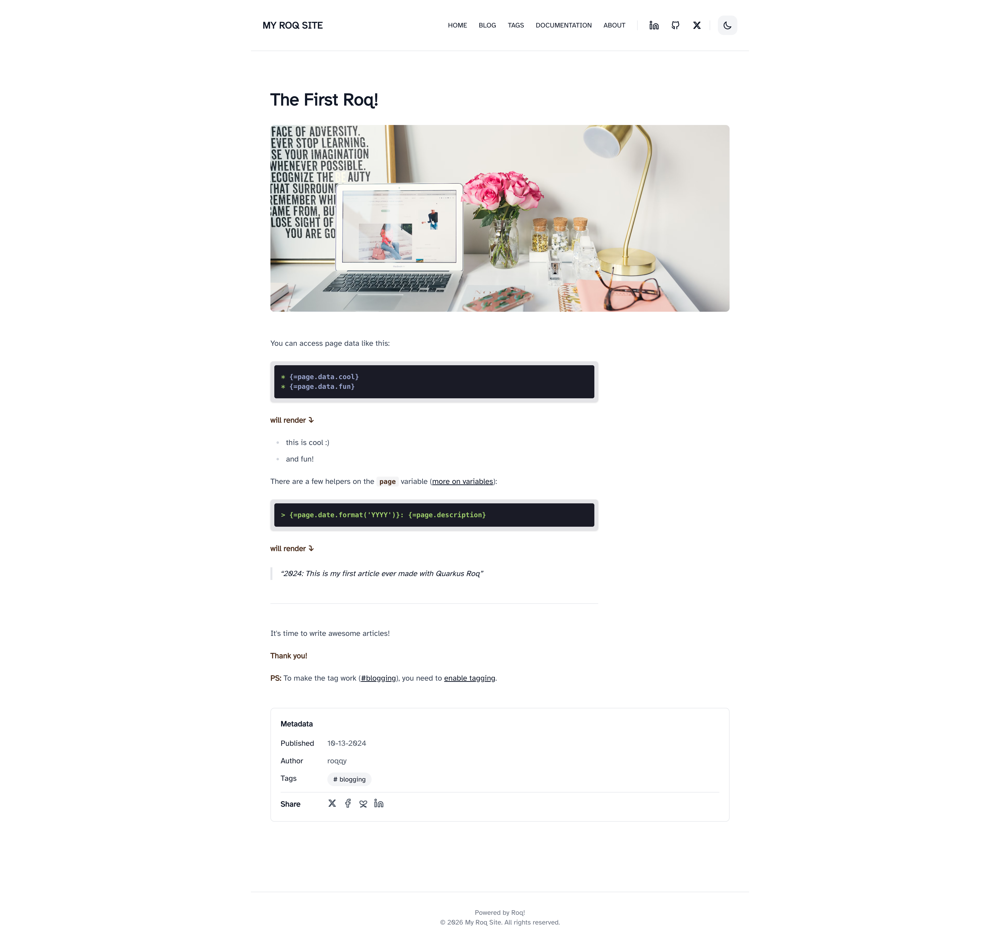

We're excited to introduce **The Code**, a new theme built for developer blogs. It's minimal, fast, and comes with everything you'd expect for a technical blog.



## What's in the box

- **Dark mode** with system preference detection and localStorage persistence
- **CSS-mask icons** for social links (no FontAwesome dependency)
- **Syntax highlighting** via highlight.js with theme-aware styling
- **Table of contents** auto-generated from headings
- **Share links** on posts (X, Facebook, Bluesky, LinkedIn)
- **Responsive** with a mobile hamburger menu
- **Atkinson Hyperlegible** font for readability



## Same starter content, two looks

When you create a new Roq site, the generated starter content (pages, posts, data files) works with both the default and The Code themes. Pick one and start writing, or switch later without touching your content.

## Switching themes

Already using the default theme? Switching is a one-line change in your `pom.xml`:

```xml
<!-- Replace this: -->
<artifactId>quarkus-roq-theme-default</artifactId>
<!-- With this: -->
<artifactId>quarkus-roq-theme-the-code</artifactId>
```

Both themes use the same layout names (`home`, `blog`, `post`, `page`, `tag`, `404`) and shared user tags (`roq/hero`, `roq/postCard`, `roq/featureCard`, `roq/authorCard`). Your content, data files, and menu just work. If you have customized partials or CSS, some adjustments may be needed to match the new theme's structure.

## CSS customization

Drop a `web/_custom.css` file into your site to override styles. It's processed by Tailwind, so `@apply` and `@theme` are available.

## Get started

```bash
roq create my-blog -x theme:the-code
```

Or check the [marketplace page]({=site.page('marketplace/themes/the-code-theme/index.md').url}) for full documentation, screenshots, and layout details.

Happy theming!
